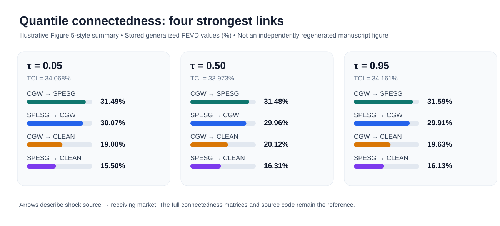
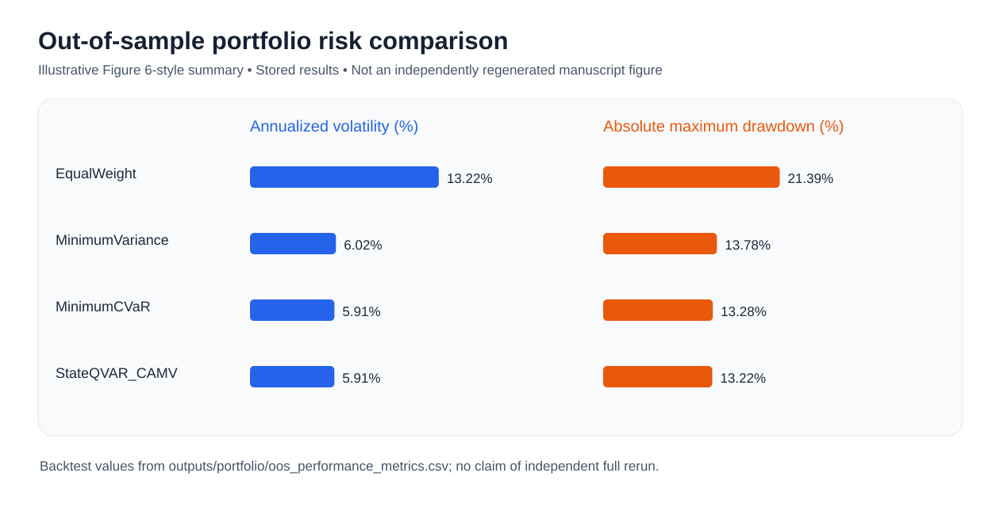

> **CONDITIONAL RELEASE NOTICE:** Read [RELEASE_STATUS.md](RELEASE_STATUS.md) before use. Market data are intentionally omitted. Full independent reproduction is pending. Source code is released under the MIT License; see LICENSE.

# State-QVAR CAMV — Official Conditional Replication Package v1.0

**Tanattrin Bunnag · Sustainability (2026), 18(20), 10634 · [Published article](https://doi.org/10.3390/su182010634)**

A publication-linked, open-source reference implementation of **State-Contingent Quantile VAR Connectedness-Adjusted Minimum-Variance Portfolio Optimization (State-QVAR CAMV)**. The repository covers quantile-based spillover networks and a state-contingent out-of-sample portfolio backtest. **MIT-licensed source code; conditional reproduction status; original market data not redistributed.**

## Visual previews (illustrative, based on bundled stored results)

The following *supplemental visual summaries* use values from the archived results; they are **not** independently regenerated manuscript figures or a substitute for the paper's published Figures 5–6.

**Quantile network highlights (Figure 5-style summary):**



**Portfolio risk comparison (Figure 6-style summary):**



See [RELEASE_STATUS.md](RELEASE_STATUS.md), [TEST_REPORT.md](TEST_REPORT.md), and [MANUSCRIPT_OUTPUT_MAP.md](MANUSCRIPT_OUTPUT_MAP.md) for limitations, validation status, and source-output mapping.

## Reproducibility package: sustainable-market quantile connectedness

This package reproduces the empirical workflow used in **Tail-Dependent
Connectedness across Carbon, Water, Clean-Energy, Green-Bond, and ESG Markets**.

## What the code does

1. Reads the seven daily series from `data/sustainability_markets.xlsx`.
2. Cleans dates, removes duplicate dates, intersects the trading calendars,
   and calculates continuously compounded percentage returns.
3. Produces descriptive statistics, correlations, ADF tests, and ARCH-LM tests.
4. Estimates QVAR(1)-GFEVD connectedness at quantiles 0.05, 0.25, 0.50,
   0.75, and 0.95; reports TCI, FROM, TO, NET, and the complete FEVD matrices.
5. Re-estimates rolling QVAR models using a 500-observation window and a
   five-observation step.
6. Calculates lower/upper-tail contrasts, stationary-bootstrap confidence
   intervals, VIX and U.S. 10-year-yield regimes, and the prespecified cluster
   decomposition.
7. Checks forecast-horizon sensitivity at H = 5, 10, and 20.
8. Exports CSV tables, publication-quality figures, an Excel results workbook,
   and a machine-readable run manifest.

## Quick start

Python 3.11 or newer is recommended.

```bash
python -m pip install -r requirements.txt
python reproduce_all.py
```

**Important:** The command requires a lawfully obtained `data/sustainability_markets.xlsx` workbook that is **not** bundled in this public repository. Without it, end-to-end reproduction cannot run.

This one command runs the connectedness analysis, the strict out-of-sample
portfolio exercise, and the manuscript-result consistency checks. The complete
run can take several minutes because the rolling analysis fits
three quantile VAR systems in every window. All outputs are written to
`outputs/`. To change the quantiles, rolling window, step, FEVD horizon, or
bootstrap settings, edit the clearly marked `USER SETTINGS` block at the top
of `run_all.py`.

`MANUSCRIPT_OUTPUT_MAP.md` identifies the exact file behind every manuscript
table and figure. `verify_manuscript_results.py` stops with an explicit error if
a revised model or extended sample no longer matches a headline number in the
current manuscript.

## Input layout

The required workbook is NOT distributed in this conditional release. The code expects the original vendor export layout. It
expects sheet `Sheet1` and the following date/value column pairs:

| Series | Date column | Value column |
|---|---:|---:|
| EUA | B | C |
| CGW | D | E |
| CLEAN | F | G |
| BGRN | H | I |
| SPESG | J | K |
| VIX | L | M |
| US10Y | N | O |

The five return series form the endogenous connectedness network. VIX and
US10Y are used only to classify external states and are not QVAR nodes.

## Important interpretation notes

- The program estimates predictive variance-share connectedness, not
  structural causality.
- Rows of every GFEVD matrix are receivers and columns are shock sources.
- `NET = TO - FROM`; positive values indicate net transmission.
- High VIX and high US10Y are defined using the full-sample 75th percentile,
  matching the manuscript.
- The code never forward-fills a closed market. Returns are calculated only
  after the common-date intersection is established.

## Reproducibility

The random seed is fixed at 2026. The package writes package versions,
configuration values, observation counts, date range, and regime thresholds to
`outputs/run_manifest.json` and `outputs/run_notes.csv`.

ADF lag length is selected automatically by BIC from a maximum of 20 daily
lags, matching Appendix Table A5 in the manuscript. When extending the sample,
the same rule is applied afresh rather than retaining sample-specific lags.

## Strict out-of-sample portfolio extension

Run `portfolio_backtest.py` after `run_all.py`. It compares equal weighting,
Ledoit-Wolf minimum variance, historical minimum CVaR, and a state-contingent
QVAR connectedness-adjusted minimum-variance allocation. The first 500 returns
form the initial estimation window; weights formed at decision date *t* are
held over *t+1* through *t+5*. Reported returns are net of 10 basis points per
unit of one-way turnover. Paired stationary-bootstrap intervals preserve both
serial dependence and the pairing between each candidate and the benchmark.

The extension writes its tables and Figure 6 to `outputs/portfolio/`.

## GitHub release candidate

The author has approved the **MIT License** for original source code in this repository. The license does not cover third-party data or other copyrighted materials. See `TEST_REPORT.md` for tested and untested claims. Original market data are not included; a full rerun requires legally obtained data.